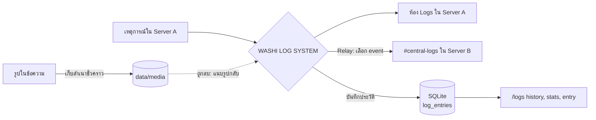
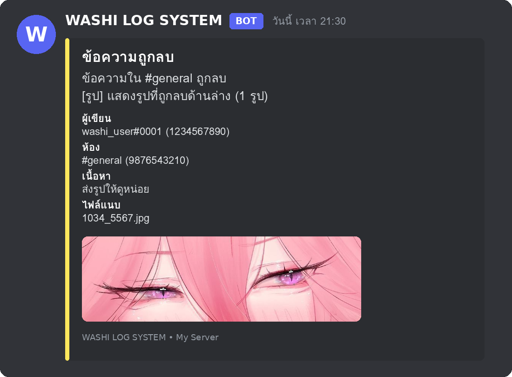

<div align="center">


<br>


**บอท Discord สำหรับบันทึกเหตุการณ์ในเซิร์ฟเวอร์ สร้างห้อง Logs ให้อัตโนมัติ**
**ค้นประวัติจากฐานข้อมูลได้ตามคนและกิจกรรม เห็นรูปที่ถูกลบ และส่ง Logs ข้ามเซิร์ฟเวอร์ได้**

[คุณสมบัติ](#คุณสมบัติ) •
[การติดตั้ง](#การติดตั้ง) •
[คำสั่ง](#คำสั่งทั้งหมด) •
[ค้นประวัติ](#ค้นประวัติ-logs-ตามคน--กิจกรรม) •
[รูปที่ถูกลบ](#ดูรูปที่ถูกลบใน-logs) •
[Relay](#ส่ง-logs-ข้ามเซิร์ฟเวอร์) •
[ข้อมูลไฟล์](#ข้อมูลไฟล์ในโปรเจกต์) •
[เครดิต](#เครดิตและสัญญาอนุญาต)

</div>

---


## คุณสมบัติ

| | ฟีเจอร์ | รายละเอียด |
|---|---|---|
| 🏗️ | **ตั้งค่าอัตโนมัติ** | `/logs setup` สร้างหมวด `LOG SERVER` และ `SYSTEM` พร้อมห้องตามรายการ |
| 📝 | **บันทึกครบ 18 กิจกรรม** | สมาชิกเข้า/ออก/ถูกเตะ, ข้อความถูกลบ/แก้ไข, ยศ, ห้อง, Voice, แบน/ปลดแบน, ชื่อเล่น, Timeout |
| 🔎 | **ค้นประวัติจากฐานข้อมูล** | `/logs history` กรองตามคน กิจกรรม ห้อง คำค้น และช่วงวัน พร้อมปุ่มเปลี่ยนหน้า |
| 📊 | **สถิติ** | `/logs stats` สรุปจำนวนตามกิจกรรมและผู้ใช้ที่มีกิจกรรมมากที่สุด |
| 🖼️ | **เห็นรูปที่ถูกลบ** | เมื่อมีคนลบข้อความที่มีรูป บอทแนบรูปนั้นกลับมาใน Logs |
| 🔀 | **Relay ข้ามเซิร์ฟเวอร์** | เลือกส่งเฉพาะ event ที่ต้องการ เช่น `message_delete,member_kick` (ส่งรูปไปด้วย) |
| 🌐 | **หลายปลายทาง** | เซิร์ฟเวอร์หนึ่งส่งไปได้หลายปลายทาง |
| 💾 | **SQLite** | เก็บค่าตั้งค่า Relay และประวัติ Logs แบบถาวร ล้างประวัติเก่าอัตโนมัติ |
| 📱 | **รันได้ทุกที่** | Android Termux, Linux และ VPS |

## ภาพรวมการทำงาน



---


## การติดตั้ง

### สิ่งที่ต้องมี

- Node.js 20 ขึ้นไป (แนะนำ Node.js 22/24)
- Discord Bot Application
- บอทต้องอยู่ทั้งเซิร์ฟเวอร์ต้นทางและปลายทางสำหรับ Relay

### Android Termux

```bash
pkg update && pkg upgrade -y
pkg install nodejs-lts git -y
git clone https://github.com/YOUR_USERNAME/WASHI-LOG-SYSTEM.git
cd WASHI-LOG-SYSTEM
```

### Linux / VPS

```bash
git clone https://github.com/YOUR_USERNAME/WASHI-LOG-SYSTEM.git
cd WASHI-LOG-SYSTEM
```

### ติดตั้งและตั้งค่า

```bash
npm install
cp .env.example .env
nano .env
```

### ตัวแปรใน `.env`

| ตัวแปร | จำเป็น | ค่าเริ่มต้น | คำอธิบาย |
|---|---|---|---|
| `DISCORD_TOKEN` | ✅ | — | Bot Token จาก Developer Portal |
| `CLIENT_ID` | ✅ | — | Application ID |
| `GUILD_ID` | | ว่าง | ใส่เพื่อ register คำสั่งเฉพาะเซิร์ฟเวอร์ทดสอบ (เห็นผลเร็ว) |
| `LOG_RETENTION_DAYS` | | `90` | เก็บประวัติ Logs ในฐานข้อมูลกี่วัน (`0` = ไม่ลบ) |
| `MEDIA_CACHE` | | `true` | เปิด/ปิดการเก็บสำเนารูปเพื่อแสดงตอนข้อความถูกลบ |
| `MEDIA_MAX_MB` | | `8` | ขนาดรูปสูงสุดที่เก็บสำเนา (MB) |
| `MEDIA_CACHE_HOURS` | | `72` | เก็บสำเนารูปกี่ชั่วโมงก่อนลบทิ้ง |

เริ่มบอท

```bash
npm start
```

ตรวจ syntax

```bash
npm run check
```

### Discord Developer Portal

1. เปิด <https://discord.com/developers/applications>
2. เลือก Application ของบอท
3. ไปที่ **Bot** แล้วเปิด Privileged Gateway Intents
   - ✅ **SERVER MEMBERS INTENT**
   - ✅ **MESSAGE CONTENT INTENT**
4. คัดลอก Bot Token ใส่ `DISCORD_TOKEN`
5. คัดลอก Application ID จาก General Information ใส่ `CLIENT_ID`
6. OAuth2 > URL Generator เลือก scopes `bot` และ `applications.commands`

### Bot permissions

| Permission | ใช้ทำอะไร |
|---|---|
| View Channels | มองเห็นห้อง |
| Send Messages | ส่ง Logs |
| Embed Links | ส่ง Embed |
| Attach Files | แนบรูปที่ถูกลบกลับมาใน Logs |
| Read Message History | อ่านประวัติข้อความ |
| Manage Channels | สำหรับ `/logs setup` |
| View Audit Log | แยก Kick จาก Leave และระบุผู้ดำเนินการ Ban/Timeout |

> [!TIP]
> ไม่จำเป็นต้องให้ Administrator หากตั้ง Permission Overwrite และสิทธิ์ห้องปลายทางถูกต้อง แนะนำเชิญด้วย Permission ที่จำเป็นเท่านั้น

### เริ่มใช้งานครั้งแรก

1. เชิญบอทเข้าเซิร์ฟเวอร์ที่ต้องการ
2. รันบอทและรอข้อความ `WASHI LOG SYSTEM online`
3. ในแต่ละเซิร์ฟเวอร์ ใช้ `/logs setup`
4. ห้องจะถูกสร้างในหมวด `LOG SERVER` และ `SYSTEM`
5. ใช้ `/logs status` เพื่อตรวจสอบ

ห้อง Logs ที่สร้างจะซ่อนจาก `@everyone` และอนุญาตให้บอทส่งข้อความได้ ผู้ดูแลที่มี Administrator จะมองเห็นได้ตามสิทธิ์ Discord

---


## คำสั่งทั้งหมด

| Command | คำอธิบาย |
|---|---|
| `/logs setup` | สร้างหมวดและห้อง |
| `/logs enable` | เปิด Logs ในเซิร์ฟเวอร์นี้ |
| `/logs disable` | ปิด Logs ในเซิร์ฟเวอร์นี้ |
| `/logs status` | ดูสถานะและจำนวนห้อง |
| `/logs channel-set` | เปลี่ยนห้องของ event หนึ่งประเภท |
| `/logs history` | ค้นประวัติ Logs ตามคน กิจกรรม ห้อง คำค้น ช่วงวัน |
| `/logs stats` | สถิติแยกตามกิจกรรมและผู้ใช้ |
| `/logs entry` | ดูรายละเอียดเต็มของรายการด้วย ID |
| `/logs relay-add` | เพิ่มเส้นทางส่ง Logs ข้ามเซิร์ฟเวอร์ |
| `/logs relay-remove` | ลบ Relay ด้วย ID |
| `/logs relay-list` | ดู Relay ทั้งหมดของเซิร์ฟเวอร์ต้นทาง |
| `/logs relay-test` | ส่งข้อความทดสอบไปทุกปลายทาง |

> [!NOTE]
> คำสั่งทั้งหมดต้องมีสิทธิ์ `Manage Server` หรือ `Administrator` และตอบกลับแบบเห็นคนเดียว

---


## ค้นประวัติ Logs ตามคน / กิจกรรม

ทุกเหตุการณ์ถูกบันทึกลงตาราง `log_entries` ในฐานข้อมูล แม้ยังไม่ได้ตั้งห้อง Logs ก็ค้นย้อนหลังได้ (ตราบที่ไม่ได้ `/logs disable`)

### ตัวกรองของ `/logs history`

| Option | ใช้ทำอะไร |
|---|---|
| `user` | เลือกผู้ใช้ ค้นทั้งกรณีเป็นผู้ถูกกระทำและผู้ดำเนินการ (เช่น แอดมินที่เตะ/แบน) |
| `user-id` | ใส่ User ID สำหรับคนที่ออกจากเซิร์ฟเวอร์ไปแล้ว |
| `event` | กิจกรรม เช่น ข้อความถูกลบ, แบน, เข้า voice |
| `channel` | ห้องที่เกิดเหตุการณ์ |
| `keyword` | คำค้นในสรุป เนื้อหา และชื่อผู้ใช้ |
| `days` | ย้อนหลังกี่วัน (1–365) |

ใส่หลายตัวกรองพร้อมกันได้ ผลลัพธ์เรียงใหม่ไปเก่า หน้าละ 8 รายการ กดปุ่ม **ก่อนหน้า / ถัดไป** เพื่อเปลี่ยนหน้า

### ตัวอย่างการใช้งาน

| ต้องการ | คำสั่ง |
|---|---|
| ดูทุกอย่างที่คน ๆ หนึ่งทำ | `/logs history user:@สมาชิก` |
| ดูว่าใครโดนแบนช่วง 30 วัน | `/logs history event:แบนสมาชิก days:30` |
| ดูข้อความที่ถูกลบของคนนี้ | `/logs history user:@สมาชิก event:ข้อความถูกลบ` |
| ค้นคนที่ออกไปแล้ว | `/logs history user-id:123456789012345678` |
| ค้นจากคำ | `/logs history keyword:ลิงก์ days:7` |
| ดูสถิติของเซิร์ฟเวอร์ | `/logs stats days:7` |
| ดูรายละเอียดรายการ #42 | `/logs entry id:42` |

> [!NOTE]
> ประวัติถูกลบอัตโนมัติเมื่อเกิน `LOG_RETENTION_DAYS` (ค่าเริ่มต้น 90 วัน)

---


## ดูรูปที่ถูกลบใน Logs

<div align="center">

</div>

วิธีทำงาน

1. เมื่อสมาชิกส่งข้อความที่มีรูป (`png`, `jpg`, `jpeg`, `gif`, `webp`) บอทดาวน์โหลดสำเนาเก็บไว้ใน `data/media/`
2. เมื่อข้อความถูกลบ บอทแนบรูปนั้นกลับมาในข้อความ Log ของ `message_delete` (สูงสุด 4 รูป) และส่งต่อไปยัง Relay ที่เลือก event นี้
3. ส่ง Log เสร็จแล้ว บอทลบสำเนาออกทันที ส่วนสำเนาที่ไม่ถูกลบจะหมดอายุตาม `MEDIA_CACHE_HOURS`
4. ใน `/logs history` รายการที่มีรูปจะมีไอคอน 🖼️

ข้อควรรู้

- ต้องให้บอทมีสิทธิ์ **Attach Files** ในห้อง Logs หากไม่มีสิทธิ์หรือส่งรูปไม่สำเร็จ บอทจะส่ง Log แบบไม่มีรูปแทน
- รูปที่ถูกส่งก่อนบอทออนไลน์ หรือเกินขนาด `MEDIA_MAX_MB` จะไม่มีสำเนา
- ไฟล์ชนิดอื่น เช่น วิดีโอ จะแสดงเฉพาะชื่อไฟล์
- ปิดฟีเจอร์ได้ด้วย `MEDIA_CACHE=false`

---


## ส่ง Logs ข้ามเซิร์ฟเวอร์

ตัวอย่าง: ส่ง Logs จาก Server A ไปห้อง `#central-logs` ใน Server B

1. เชิญบอทเข้า Server A และ Server B
2. ใน Server B ตรวจสอบว่าบอทเห็นห้องและมี `View Channel`, `Send Messages`, `Embed Links`, `Attach Files`
3. ใน Server A ใช้ `/logs relay-add`
4. กรอก `destination-guild-id` และ `destination-channel-id`
5. กรอก `events` เป็น `all` หรือ event keys คั่นด้วย comma

ตัวอย่างส่งเฉพาะข้อความถูกลบ, สมาชิกถูกเตะ และการแบน

```text
message_delete,member_kick,ban_add
```

### Event keys ที่รองรับ

| หมวด | Event keys |
|---|---|
| 👤 สมาชิก | `member_join` `member_leave` `member_kick` `nickname_update` `timeout_update` |
| 💬 ข้อความ | `message_delete` `message_update` |
| 🎭 ยศ | `role_create` `role_delete` `role_update` |
| 📁 ห้อง | `channel_create` `channel_delete` `channel_update` |
| 🔊 Voice | `voice_join` `voice_leave` `voice_move` |
| 🔨 แบน | `ban_add` `ban_remove` |

> [!IMPORTANT]
> Relay เป็นทิศทางเดียวตามที่เพิ่มไว้ หากต้องการ A → B และ B → A ให้เพิ่ม Relay แยกใน Server B ด้วย บอทจะไม่ส่งต่อข้อความ Logs ของตัวเองซ้ำ เพราะ event handler ข้ามข้อความจากบอท

---


## ฐานข้อมูลและการสำรอง

ฐานข้อมูลอยู่ที่ `data/washi-logs.sqlite` (ใช้ [sql.js](https://github.com/sql-js/sql.js) ไม่ต้องคอมไพล์ native module จึงรันบน Termux และโฮสต์แชร์ได้)

| ตาราง | เก็บอะไร |
|---|---|
| `guild_settings` | เปิด/ปิด Logs ของแต่ละเซิร์ฟเวอร์ |
| `log_channels` | ห้อง Logs ของแต่ละ event |
| `relays` | เส้นทาง Relay ข้ามเซิร์ฟเวอร์ |
| `log_entries` | ประวัติ Logs: กิจกรรม ผู้ใช้ ผู้ดำเนินการ ห้อง สรุป เนื้อหา เวลา |
| `media_cache` | รายการสำเนารูปชั่วคราวที่รอแสดงตอนข้อความถูกลบ |

สำรองข้อมูล

```bash
cp data/washi-logs.sqlite data/washi-logs.backup.sqlite
```

เก็บไฟล์ฐานข้อมูลนี้ไว้เมื่อย้ายเครื่อง เพื่อรักษาการตั้งค่า Relay และประวัติ Logs ทั้งหมด

---


## ข้อมูลไฟล์ในโปรเจกต์

```text
WASHI-LOG-SYSTEM/
├── assets/                    รูปประกอบ README
│   ├── banner.png
│   ├── credit.png
│   ├── preview-delete-log.png
│   └── section-*.png
├── data/                      ข้อมูลที่บอทสร้าง (ไม่ถูก commit)
│   ├── .gitkeep
│   ├── washi-logs.sqlite
│   └── media/
├── src/
│   ├── index.js
│   ├── config.js
│   ├── db.js
│   ├── logger.js
│   ├── media.js
│   ├── history.js
│   ├── commands.js
│   ├── setup.js
│   └── events/
│       └── index.js
├── .env.example
├── .gitignore
├── CHANGELOG.md
├── CONTRIBUTING.md
├── LICENSE
├── package.json
├── README.md
└── SECURITY.md
```

| ไฟล์ | หน้าที่ |
|---|---|
| `src/index.js` | จุดเริ่มต้น สร้าง Client, โหลด event, ตั้งงานล้างข้อมูลเก่าทุกชั่วโมง |
| `src/config.js` | รายการ event, ชื่อห้อง/หมวด, ค่าตั้งจาก `.env` |
| `src/db.js` | ฐานข้อมูล SQLite: ตั้งค่า Relay ประวัติ Logs และแคชรูป |
| `src/logger.js` | สร้าง Embed ส่งเข้าห้อง Logs และ Relay พร้อมแนบรูป |
| `src/media.js` | ดาวน์โหลด เก็บ และลบสำเนารูป |
| `src/history.js` | คำสั่ง `/logs history`, `/logs stats`, `/logs entry` |
| `src/commands.js` | นิยามและจัดการ Slash commands |
| `src/setup.js` | สร้างหมวดและห้อง Logs ใน `/logs setup` |
| `src/events/index.js` | ตัวดักเหตุการณ์ Discord ทั้งหมดและบันทึกลงประวัติ |
| `.env.example` | ตัวอย่างค่าตั้ง คัดลอกเป็น `.env` |
| `CHANGELOG.md` | ประวัติการเปลี่ยนแปลงแต่ละเวอร์ชัน |
| `CONTRIBUTING.md` | แนวทางร่วมพัฒนา |
| `SECURITY.md` | นโยบายความปลอดภัยและการแจ้งช่องโหว่ |
| `LICENSE` | MIT License |

---

## ข้อจำกัด

- Discord ส่ง event ตาม Gateway Intent และข้อมูลที่บอทได้รับเท่านั้น
- เนื้อหาข้อความที่ถูกลบก่อนบอทได้รับ หรือหลุดจาก cache (เช่น หลังรีสตาร์ท) อาจไม่มีให้บันทึก ส่วนรูปจะแสดงได้ตามเงื่อนไขของสำเนารูปด้านบน
- การตรวจจับ Kick, Ban, Timeout ใช้ Audit Log และอาจไม่ระบุผู้ดำเนินการหากไม่มีสิทธิ์ View Audit Log หรือ Audit Log ยังไม่พร้อม
- ยังไม่รองรับเป็น event แยก: การเปลี่ยน Permission Overwrite ภายในห้อง, การสร้าง Invite, การลบข้อความจำนวนมาก
- ห้องใน `SYSTEM` เป็นห้องโครงสร้างสำหรับต่อยอด ไม่ใช่ระบบ Automod/Wick ทดแทน
- คำสั่ง Global อาจใช้เวลาสักพักกว่าจะปรากฏ หากกำลังทดสอบ ให้ใส่ `GUILD_ID` ใน `.env`
- ขนาดไฟล์ที่แนบได้ขึ้นกับระดับของเซิร์ฟเวอร์ปลายทาง หากเกินจะส่ง Log แบบไม่มีรูป

## แก้ปัญหา

<details>
<summary><b>คำสั่ง <code>/logs</code> ไม่ขึ้น</b></summary>

- ตรวจ `CLIENT_ID`, Token และ scope `applications.commands`
- ใส่ `GUILD_ID` ชั่วคราวเพื่อทดสอบเร็วขึ้น
- ปิดและเปิดบอทใหม่

</details>

<details>
<summary><b><code>/logs setup</code> สร้างห้องไม่ได้</b></summary>

- เพิ่ม `Manage Channels`
- ตรวจว่าบอทมีสิทธิ์จัดการหมวดหมู่และห้อง

</details>

<details>
<summary><b>Logs ไม่เข้า</b></summary>

- ใช้ `/logs status`
- ตรวจว่าห้องยังอยู่และบอทมี View Channel / Send Messages / Embed Links
- ตรวจว่าไม่ได้ใช้ `/logs disable`

</details>

<details>
<summary><b>รูปที่ถูกลบไม่แสดง</b></summary>

- ตรวจว่า `MEDIA_CACHE` ไม่ได้ตั้งเป็น `false`
- ตรวจว่าบอทมีสิทธิ์ Attach Files ในห้อง Logs
- รูปต้องถูกส่งตอนบอทออนไลน์ ขนาดไม่เกิน `MEDIA_MAX_MB` และเป็นไฟล์ png/jpg/gif/webp
- ตรวจว่ามีโฟลเดอร์ `data/media/` และบอทเขียนไฟล์ได้

</details>

<details>
<summary><b><code>/logs history</code> ไม่พบรายการ</b></summary>

- ระบบเริ่มบันทึกประวัติตั้งแต่อัปเดตเป็น 1.1.0 เหตุการณ์ก่อนหน้านั้นไม่มีในฐานข้อมูล
- ตรวจว่าไม่ได้ `/logs disable` และ `LOG_RETENTION_DAYS` ไม่สั้นเกินไป
- ลองลดตัวกรอง หรือใช้ `user-id` แทน `user`

</details>

<details>
<summary><b>Relay ไม่ทำงาน</b></summary>

- บอทต้องอยู่ในปลายทาง
- ตรวจ Guild ID และ Channel ID
- ตรวจ Permission ในห้องปลายทาง
- ใช้ `/logs relay-test`

</details>

---


## เครดิตและสัญญาอนุญาต

<div align="center">


| | |
|---|---|
| 👤 **พัฒนาโดย** | **Washi** |
| 🎨 **ภาพประกอบ** | Washiria Nosee |
| 🧰 **เครื่องมือ** | [discord.js](https://discord.js.org) • [Node.js](https://nodejs.org) • [sql.js](https://github.com/sql-js/sql.js) |
| 📄 **สัญญาอนุญาต** | [MIT License](LICENSE) © 2026 Washi |

ร่วมพัฒนา: [CONTRIBUTING.md](CONTRIBUTING.md) • ประวัติเวอร์ชัน: [CHANGELOG.md](CHANGELOG.md) • ความปลอดภัย: [SECURITY.md](SECURITY.md)

หากโปรเจกต์นี้มีประโยชน์ อย่าลืมกด ⭐ ให้ Repository

<sub>Made with care by <b>Washi</b></sub>

</div>
