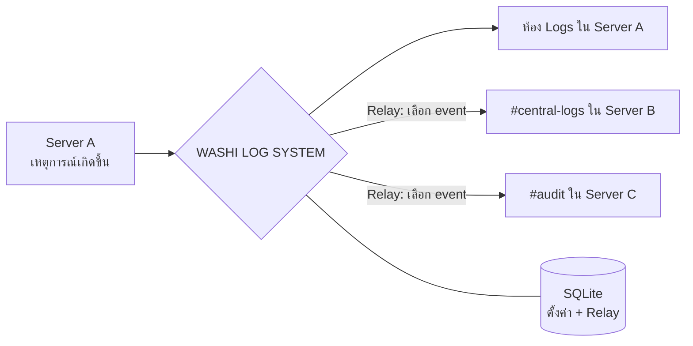

<div align="center">


<br>


**บอท Discord สำหรับบันทึกเหตุการณ์ในเซิร์ฟเวอร์ สร้างห้อง Logs ให้อัตโนมัติ**
**และส่ง Logs ข้ามเซิร์ฟเวอร์แบบเลือก event ได้**

[คุณสมบัติ](#-คุณสมบัติ) •
[การติดตั้ง](#-การติดตั้ง) •
[คำสั่ง](#-คำสั่ง) •
[Relay](#-relay-ข้ามเซิร์ฟเวอร์) •
[แก้ปัญหา](#-แก้ปัญหา) •
[เครดิต](#-เครดิต)

</div>

---

## ✨ คุณสมบัติ

| | ฟีเจอร์ | รายละเอียด |
|---|---|---|
| 🏗️ | **ตั้งค่าอัตโนมัติ** | `/logs setup` สร้างหมวด `LOG SERVER` และ `SYSTEM` พร้อมห้องตามรายการ |
| 📝 | **บันทึกครบ** | สมาชิกเข้า/ออก/ถูกเตะ, ข้อความถูกลบ/แก้ไข, ยศ, ห้อง, Voice, แบน/ปลดแบน, ชื่อเล่น, Timeout |
| 🎯 | **กำหนดห้องรายประเภท** | เปลี่ยนห้อง Logs ของแต่ละ event ได้เอง |
| 🔀 | **Relay ข้ามเซิร์ฟเวอร์** | เลือกส่งเฉพาะ event ที่ต้องการ เช่น `message_delete,member_kick` |
| 🌐 | **หลายปลายทาง** | เซิร์ฟเวอร์หนึ่งส่งไปได้หลายปลายทาง |
| 💾 | **SQLite** | เก็บค่าตั้งค่าและ Relay แบบถาวร |
| 📱 | **รันได้ทุกที่** | Android Termux, Linux และ VPS |

---

## 🧭 ภาพรวมการทำงาน



---

## 📦 สิ่งที่ต้องมี

- Node.js 20 ขึ้นไป (แนะนำ Node.js 22/24)
- Discord Bot Application
- บอทต้องอยู่ทั้งเซิร์ฟเวอร์ต้นทางและปลายทางสำหรับ Relay

---

## 🚀 การติดตั้ง

### Android Termux

```bash
pkg update && pkg upgrade -y
pkg install nodejs-lts git -y
mkdir -p ~/WASHI-LOG-SYSTEM
cd ~/WASHI-LOG-SYSTEM
```

### Linux / VPS

```bash
git clone https://github.com/YOUR_USERNAME/WASHI-LOG-SYSTEM.git
cd WASHI-LOG-SYSTEM
```

### ติดตั้งและตั้งค่า

```bash
npm install
cp .env.example .env
nano .env
```

ใส่ค่าใน `.env`

```env
DISCORD_TOKEN=ใส่_BOT_TOKEN
CLIENT_ID=ใส่_APPLICATION_ID
GUILD_ID=
```

เริ่มบอท

```bash
npm start
```

ตรวจ syntax

```bash
npm run check
```

---

## 🔧 Discord Developer Portal

1. เปิด <https://discord.com/developers/applications>
2. เลือก Application ของบอท
3. ไปที่ **Bot** แล้วเปิด Privileged Gateway Intents
   - ✅ **SERVER MEMBERS INTENT**
   - ✅ **MESSAGE CONTENT INTENT**
4. คัดลอก Bot Token ใส่ `DISCORD_TOKEN`
5. คัดลอก Application ID จาก General Information ใส่ `CLIENT_ID`
6. OAuth2 > URL Generator เลือก scopes `bot` และ `applications.commands`

### Bot permissions

| Permission | ใช้ทำอะไร |
|---|---|
| View Channels | มองเห็นห้อง |
| Send Messages | ส่ง Logs |
| Embed Links | ส่ง Embed |
| Read Message History | อ่านประวัติข้อความ |
| Manage Channels | สำหรับ `/logs setup` |
| View Audit Log | แยกเหตุการณ์ Kick ออกจาก Leave |

> [!TIP]
> ไม่จำเป็นต้องให้ Administrator หากตั้ง Permission Overwrite และสิทธิ์ห้องปลายทางถูกต้อง แนะนำเชิญด้วย Permission ที่จำเป็นเท่านั้น

---

## 🏁 เริ่มใช้งานครั้งแรก

1. เชิญบอทเข้าเซิร์ฟเวอร์ที่ต้องการ
2. รันบอทและรอข้อความ `WASHI LOG SYSTEM online`
3. ในแต่ละเซิร์ฟเวอร์ ใช้ `/logs setup`
4. ห้องจะถูกสร้างในหมวด `LOG SERVER` และ `SYSTEM`
5. ใช้ `/logs status` เพื่อตรวจสอบ

ห้อง Logs ที่สร้างจะซ่อนจาก `@everyone` และอนุญาตให้บอทส่งข้อความได้ ผู้ดูแลที่มี Administrator จะมองเห็นได้ตามสิทธิ์ Discord

---

## 💬 คำสั่ง

| Command | คำอธิบาย |
|---|---|
| `/logs setup` | สร้างหมวดและห้อง |
| `/logs enable` | เปิด Logs ในเซิร์ฟเวอร์นี้ |
| `/logs disable` | ปิด Logs ในเซิร์ฟเวอร์นี้ |
| `/logs status` | ดูสถานะและจำนวนห้อง |
| `/logs channel-set` | เปลี่ยนห้องของ event หนึ่งประเภท |
| `/logs relay-add` | เพิ่มเส้นทางส่ง Logs ข้ามเซิร์ฟเวอร์ |
| `/logs relay-remove` | ลบ Relay ด้วย ID |
| `/logs relay-list` | ดู Relay ทั้งหมดของเซิร์ฟเวอร์ต้นทาง |
| `/logs relay-test` | ส่งข้อความทดสอบไปทุกปลายทาง |

> [!NOTE]
> คำสั่งจัดการต้องมีสิทธิ์ `Manage Server` หรือ `Administrator`

---

## 🔀 Relay ข้ามเซิร์ฟเวอร์

ตัวอย่าง: ส่ง Logs จาก Server A ไปห้อง `#central-logs` ใน Server B

1. เชิญบอทเข้า Server A และ Server B
2. ใน Server B ตรวจสอบว่าบอทเห็นห้องและมี `View Channel`, `Send Messages`, `Embed Links`
3. ใน Server A ใช้ `/logs relay-add`
4. กรอก `destination-guild-id` และ `destination-channel-id`
5. กรอก `events` เป็น `all` หรือ event keys คั่นด้วย comma

ตัวอย่างส่งเฉพาะข้อความถูกลบ, สมาชิกถูกเตะ และการแบน

```text
message_delete,member_kick,ban_add
```

### Event keys ที่รองรับ

| หมวด | Event keys |
|---|---|
| 👤 สมาชิก | `member_join` `member_leave` `member_kick` `nickname_update` `timeout_update` |
| 💬 ข้อความ | `message_delete` `message_update` |
| 🎭 ยศ | `role_create` `role_delete` `role_update` |
| 📁 ห้อง | `channel_create` `channel_delete` `channel_update` |
| 🔊 Voice | `voice_join` `voice_leave` `voice_move` |
| 🔨 แบน | `ban_add` `ban_remove` |

> [!IMPORTANT]
> Relay เป็นทิศทางเดียวตามที่เพิ่มไว้ หากต้องการ A → B และ B → A ให้เพิ่ม Relay แยกใน Server B ด้วย บอทจะไม่ส่งต่อข้อความ Logs ของตัวเองซ้ำ เพราะ event handler ข้ามข้อความจากบอท

---

## 💾 ฐานข้อมูลและการสำรอง

ฐานข้อมูลอยู่ที่

```text
data/washi-logs.sqlite
```

สำรองข้อมูล

```bash
cp data/washi-logs.sqlite data/washi-logs.backup.sqlite
```

เก็บไฟล์ฐานข้อมูลนี้ไว้เมื่อย้ายเครื่อง เพื่อรักษาการตั้งค่าและ Relay ทั้งหมด

---

## ⚠️ ข้อจำกัด

- Discord ส่ง event ตาม Gateway Intent และข้อมูลที่บอทได้รับเท่านั้น
- ข้อความที่ถูกลบก่อนบอทได้รับ/แคชเนื้อหา อาจไม่มีเนื้อหาให้บันทึก
- การตรวจจับ Kick ใช้ Audit Log และอาจแสดงเป็น Leave หากไม่มีสิทธิ์ View Audit Log หรือ Audit Log ยังไม่พร้อม
- ยังไม่รองรับเป็น event แยก: การเปลี่ยน Permission Overwrite ภายในห้อง, การสร้าง Invite, การลบข้อความจำนวนมาก และรายละเอียด Audit Log ขั้นสูง
- ห้องใน `SYSTEM` เป็นห้องโครงสร้างสำหรับต่อยอด ไม่ใช่ระบบ Automod/Wick ทดแทน
- คำสั่ง Global อาจใช้เวลาสักพักกว่าจะปรากฏ หากกำลังทดสอบ ให้ใส่ `GUILD_ID` ใน `.env` เพื่อ register แบบเฉพาะเซิร์ฟเวอร์

---

## 🩺 แก้ปัญหา

<details>
<summary><b>คำสั่ง <code>/logs</code> ไม่ขึ้น</b></summary>

- ตรวจ `CLIENT_ID`, Token และ scope `applications.commands`
- ใส่ `GUILD_ID` ชั่วคราวเพื่อทดสอบเร็วขึ้น
- ปิดและเปิดบอทใหม่

</details>

<details>
<summary><b><code>/logs setup</code> สร้างห้องไม่ได้</b></summary>

- เพิ่ม `Manage Channels`
- ตรวจว่าบอทมีสิทธิ์จัดการหมวดหมู่และห้อง

</details>

<details>
<summary><b>Logs ไม่เข้า</b></summary>

- ใช้ `/logs status`
- ตรวจว่าห้องยังอยู่และบอทมี View Channel / Send Messages / Embed Links
- ตรวจว่าไม่ได้ใช้ `/logs disable`

</details>

<details>
<summary><b>Relay ไม่ทำงาน</b></summary>

- บอทต้องอยู่ในปลายทาง
- ตรวจ Guild ID และ Channel ID
- ตรวจ Permission ในห้องปลายทาง
- ใช้ `/logs relay-test`

</details>

---

## 📁 โครงสร้างไฟล์

```text
WASHI-LOG-SYSTEM/
├── assets/
│   └── banner.svg
├── data/
│   └── washi-logs.sqlite
├── .env.example
├── .gitignore
├── CHANGELOG.md
├── CONTRIBUTING.md
├── LICENSE
├── README.md
└── SECURITY.md
```

---

## 🤝 ร่วมพัฒนา

ยินดีรับ Issue และ Pull Request อ่านแนวทางที่ [CONTRIBUTING.md](CONTRIBUTING.md) และดูประวัติการเปลี่ยนแปลงที่ [CHANGELOG.md](CHANGELOG.md)

พบช่องโหว่ด้านความปลอดภัย อ่าน [SECURITY.md](SECURITY.md)

---

## 🏆 เครดิต

<div align="center">

### พัฒนาโดย **Washi**

ขอบคุณ [discord.js](https://discord.js.org) และ [Node.js](https://nodejs.org) ที่เป็นรากฐานของโปรเจกต์นี้

หากโปรเจกต์นี้มีประโยชน์ อย่าลืมกด ⭐ ให้ Repository

Released under the [MIT License](LICENSE) © 2026 Washi

<sub>Made with care by <b>Washi</b></sub>

</div>
